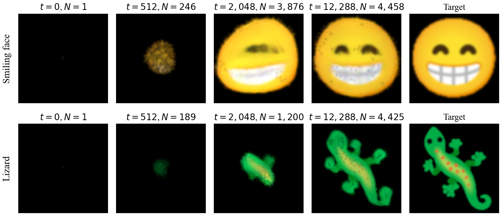
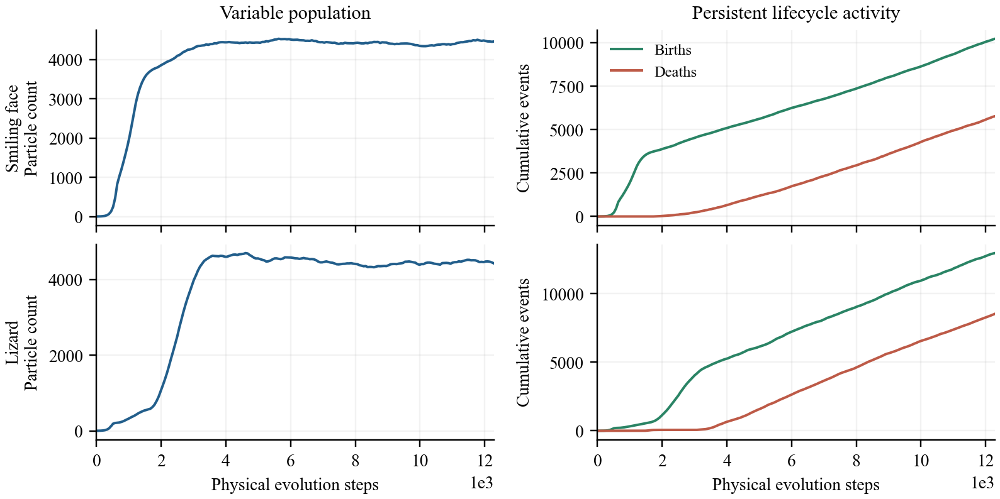
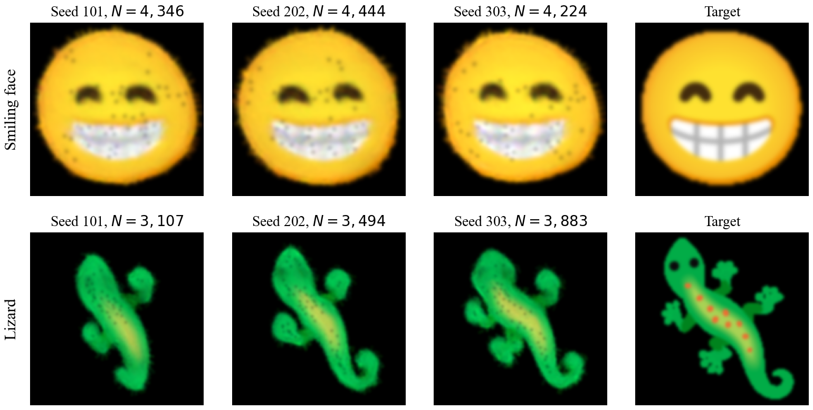

# LocalGrowthNPA

**Single-seed growth with local birth–death particle rules.**

**通过局部生死粒子规则，从单粒子开始生长。**

Zheng Fang · Faculty of Information, Liaoning University  
方正 · 辽宁大学信息学部

This project studies a variable-population extension of [Neural Particle Automata (NPA)](https://arxiv.org/abs/2601.16096). A shared local rule moves particles and updates their internal states. A separate lifecycle head scores nearby birth candidates and retention. New particles inherit the parent's state, and local spacing and density checks resolve birth and death events. Training uses rendered image residuals to supervise virtual births; deployed particle updates do not query target pixels or cameras. Target-calibrated scalar constants and a finite resource capacity are retained.

本项目研究 [Neural Particle Automata（NPA，神经粒子自动机）](https://arxiv.org/abs/2601.16096)的可变粒子数量扩展。共享局部规则更新粒子的位置和内部状态；另一个生死网络判断附近候选位置的出生和已有粒子的保留。子代继承母体状态，出生和删除经过局部间距、密度检查。训练时使用图像残差为虚拟出生提供监督；部署时的粒子更新不查询目标像素或相机，但保留训练时校准的标量常数和有限资源容量。

## Single-seed examples / 单粒子生长示例

The panels above are direct model renders from a new seed-101 evaluation of two archived 30,000-update checkpoints. Labels distinguish physical evolution steps from training updates. Events occur every 64 physical steps. The last column is the rendered training target. Both targets are shown at predetermined steps; no generated image was retouched.

上图由两份历史30000次参数更新的权重，在新的种子101推理中直接渲染产生。标签中的演化步数与训练更新数是不同单位，每64个物理步执行一次生死事件。末列为渲染后的训练目标。两行均使用预先确定的展示时刻，没有修饰生成图像。

| Target / 目标 | Final particles / 最终粒子数 | Births / 出生 | Deaths / 死亡 | Final IoU / 最终轮廓交并比 | Final RGB MSE / 最终颜色均方误差 |
|---|---:|---:|---:|---:|---:|
| Smiling face / 笑脸 | 4,458 | 10,225 | 5,768 | 0.9446 | 0.00620 |
| Lizard / 蜥蜴 | 4,425 | 12,943 | 8,519 | 0.7414 | 0.01071 |

Both evaluations start with one particle, finish 12,288 physical steps, and record zero capacity contacts. These are final-frame measurements from a restored compatible implementation, separate from the historical three-seed tail-window measurements below. Different restored and historical trajectories are observable; the new runs are not claimed to be bitwise reproductions.

两次推理均从一个粒子开始，完成12288个物理步，没有触及容量上限。表中是恢复后兼容实现的新推理终点指标，与下面历史三种子验证的末段指标分开解释。新旧运行轨迹存在差异，不宣称逐位复现。

## Historical evaluation / 历史独立验证

All three recorded evaluation seeds (101, 202, 303) are displayed at their terminal states after 12,288 steps. Over the last 20 windows, the minimum silhouette IoU ranges from 0.9362 to 0.9526 for the face and from 0.3939 to 0.5462 for the lizard. None meets the complete stored convergence criterion. The checkpoints demonstrate variable-population growth and lifecycle turnover; accurate long-term morphology and damage recovery require separate evidence. Training included documented mid-run changes to its teachers and feedback, so these checkpoints are not controlled ablations.

上图按编号展示全部三个历史独立种子（101、202、303）在12288步的终点状态。末20个窗口中的最低轮廓交并比，笑脸为0.9362至0.9526，蜥蜴为0.3939至0.5462；六次历史验证均未满足完整的原收敛标准。它们支持可变数量生长与持续生死事件；准确的长期形态维护和损伤恢复仍需各自的证据。训练中途有记录在案的教师与反馈变更，因此不能作为受控消融。

## Paper and materials / 论文与材料

**LocalGrowthNPA: Single-Seed Growth with Local Birth–Death Particle Rules**  
**LocalGrowthNPA：通过局部生死粒子规则实现单粒子生长**

An arXiv manuscript is being prepared. An arXiv identifier will be added after public announcement; no arXiv acceptance or publication is claimed here.

arXiv预印本正在准备中。正式公开后再补充论文编号；此处尚不代表arXiv已接收或发表。

This public repository contains project information and generated figures. **For research code, model checkpoints, or additional materials, please contact the author.**

本公开仓库提供项目说明和生成示意图。**如需研究代码、模型权重或其他补充材料，请联系作者。**

## Contact / 联系作者

- Author / 作者：Zheng Fang（方正）
- Affiliation / 单位：Faculty of Information, Liaoning University（辽宁大学信息学部）
- Email / 邮箱：[1640691243@qq.com](mailto:1640691243@qq.com)
- WeChat / 微信：scan the QR code below（扫描下方二维码添加作者）。

## Acknowledgments / 致谢

The implementation inherits or adapts the NPA state representation, SPH perception, continuous updates, and original rendering objectives. We thank its authors and link the original [paper](https://arxiv.org/abs/2601.16096), [project page](https://selforg-npa.github.io/), and [code](https://github.com/TheDevilWillBeBee/NPA). Learned growth, cell division, local communication, and inherited state have broader prior art; the project does not claim these ideas in isolation. See [provenance](PROVENANCE.md).

实现继承或改编了NPA的状态表示、SPH（光滑粒子流体动力学）感知、连续更新和原始渲染目标。感谢原作者，相关链接为[原论文](https://arxiv.org/abs/2601.16096)、[项目主页](https://selforg-npa.github.io/)和[原始代码](https://github.com/TheDevilWillBeBee/NPA)。学习式生长、细胞分裂、局部通信和状态继承已有更广泛的前人研究，本项目不将这些思想本身宣称为首创。详见[来源说明](PROVENANCE.md)。
